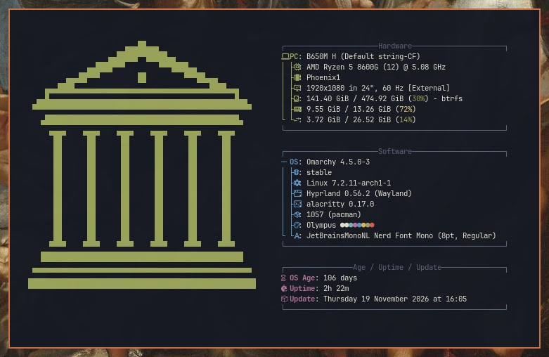

# Olympus extras

Optional companion to the [Olympus theme](https://github.com/JeanpiDev/omarchy-olympus-theme) for [Omarchy](https://omarchy.org).

Omarchy's *About* logo and screensaver art are global, and installing a theme never runs code. This repository holds a small `theme-set` hook that swaps in the Olympus temple while Olympus is the active theme, and puts your previous art back when you switch to any other theme (anything you edited meanwhile is left alone). The art itself ships with the theme in `extras/`.

| About | Screensaver |
|---|---|
|  |  |

## Install

```bash
omarchy theme install https://github.com/JeanpiDev/omarchy-olympus-theme
git clone https://github.com/JeanpiDev/omarchy-olympus-extras ~/.local/src/omarchy-olympus-extras
bash ~/.local/src/omarchy-olympus-extras/install.sh
```

## Remove

```bash
bash ~/.local/src/omarchy-olympus-extras/uninstall.sh
```

## Files

| File | Purpose |
|---|---|
| `olympus-branding.sh` | The hook, installed into `~/.config/omarchy/hooks/theme-set.d/` |
| `install.sh` | Installs the hook and applies it to the current theme |
| `uninstall.sh` | Restores your previous art and removes the hook |

## License

MIT
